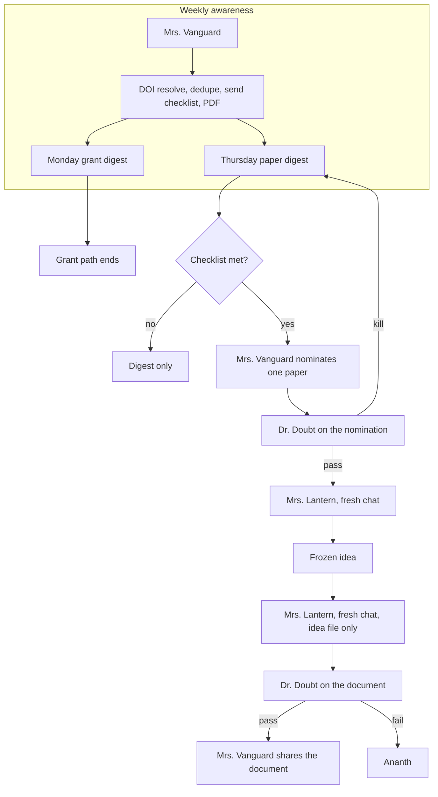

# Career management

Open this folder as its own Cursor project (File → Open Folder → `output/career-management`). Use `AGENTS.md` as the front door and the role files under `.cursor/agents/` when you invoke a specialist.

The frozen design is `ARCHITECTURE.md`. Do not redesign from this README.

## Flowchart

## PDFs

Each path is markdown in `runs/YYYY-MM-DD/`. Ask in this project to generate the PDF for the grant path, the paper path, or the idea path. Mrs. Vanguard runs `python3 scripts/render_pdf.py <grant|paper|idea>`. The PDF is written next to the markdown. No HTML is kept. `site/` is an old static copy and is not part of this path.

## Human checkpoints

- What science to stand behind.
- Whether to apply, and to which call.
- A document Dr. Doubt failed.
- Any change to remit, recipients, or this path.

